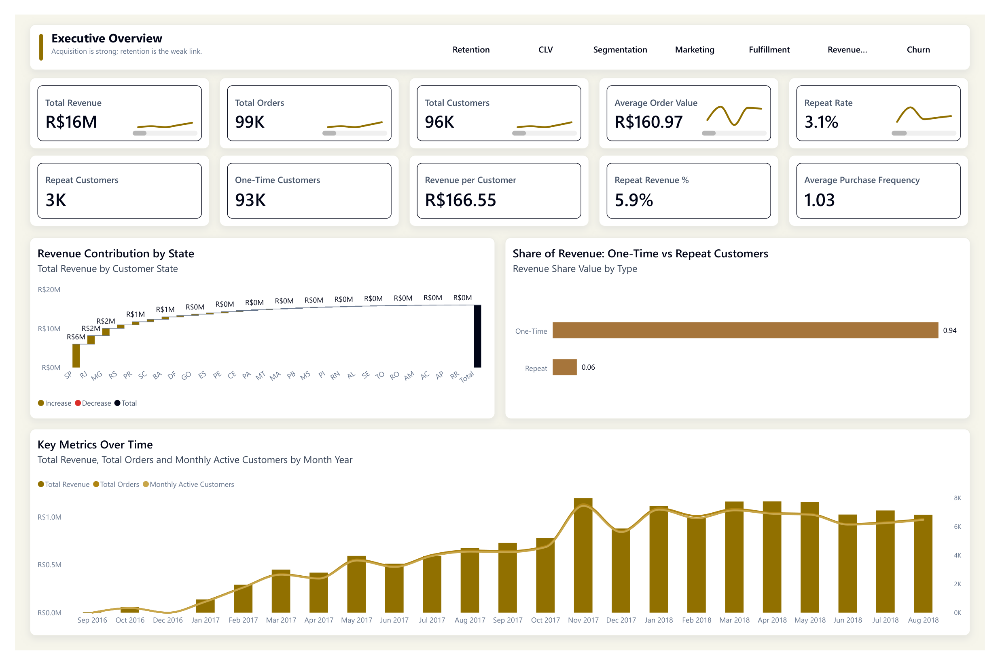
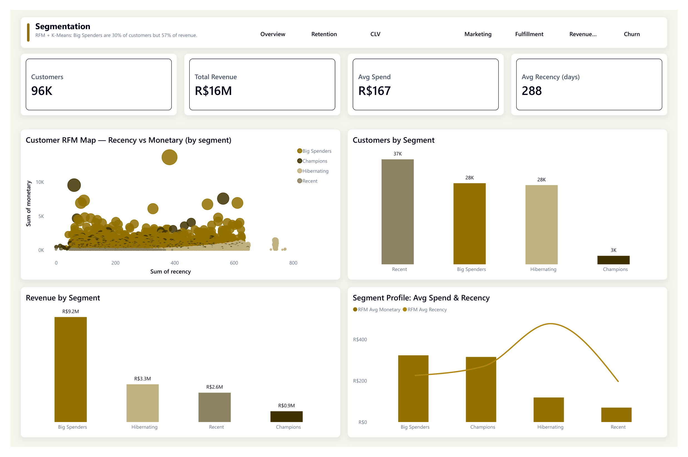
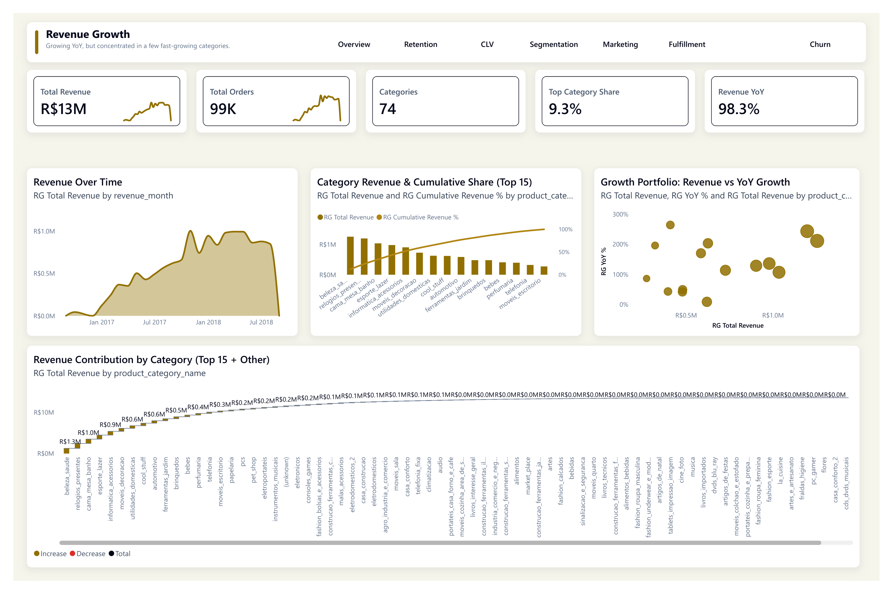
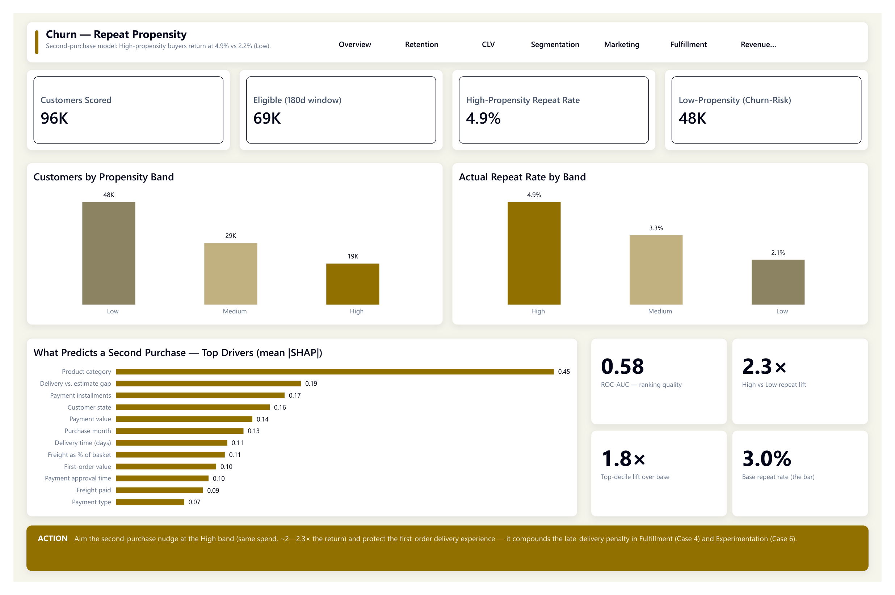

# E-commerce Growth Analytics

A data analytics project built on the Brazilian Olist e-commerce dataset. It carries
raw order data through a PostgreSQL warehouse, a library of SQL analyses, a Python ML
and statistics layer, and an eight-page Power BI report. The work is organised around the
growth questions a leadership team would actually ask.

The goal is decision support, not a wall of charts: find where growth stalls, size the
impact, and say what to do next.

**📊 The dashboard** — the eight-page Power BI report lives in
[`dashboards/`](dashboards/) as a PBIP project. Open
[`product_growth_analytics_lab.pbip`](dashboards/product_growth_analytics_lab.pbip) in
[Power BI Desktop](https://powerbi.microsoft.com/desktop/) (free) and refresh against a
local copy of the warehouse. The capstone read is the
[**Executive Growth Strategy**](docs/executive_growth_strategy.md).

## Dashboard

An eight-page narrative styled on the Microsoft Fluent 2 design system — Overview ·
Retention · CLV · Segmentation · Marketing · Fulfillment · Revenue Growth · Churn.

| | |
|:---:|:---:|
|  |  |
| **Overview** — KPIs, trend, and the growth problem at a glance | **Segmentation** — ML (RFM + K-Means) segments; Big Spenders drive 57% of revenue |
|  |  |
| **Revenue Growth** — trend, category Pareto, and a monthly revenue bridge | **Churn** — second-purchase propensity bands and SHAP drivers |

**[📄 View the full dashboard (all 8 pages, PDF)](dashboards/dashboard_screenshots/product_growth_analytics_lab_dashboard.pdf)** — no Power BI needed.

Scope is kept honest. Where the data cannot answer a question, the project says so and
frames the analysis around what the data does support.

---

## Dataset

[Brazilian E-Commerce Public Dataset by Olist](https://www.kaggle.com/datasets/olistbr/brazilian-ecommerce)
(Kaggle): roughly 99K orders from 2016–2018, 96K customers, and R$16M in revenue, plus
order items, payments, reviews, and geolocation.

Two gaps shape the analysis:

- No marketing spend, channel, or attribution data, so CAC, ROAS, and payback cannot be
  computed.
- No clickstream, so a visit-to-purchase conversion funnel is not possible.

---

## Tech stack

| Layer | Tools |
|---|---|
| Storage and data prep | PostgreSQL |
| ETL, ML, statistics | Python (pandas, scikit-learn, scipy, statsmodels) |
| Analysis and validation | SQL (CTEs, window and ranking functions, multi-table joins) |
| Reporting | Power BI (PBIP), styled on the Microsoft Fluent 2 design system |
| Calculation layer | DAX |

---

## Repository structure

```
data/         Raw Olist CSVs (gitignored) and processed output
src/          Python: config, database build, ETL, ML, experimentation, utils
sql/
  setup/            Table and staging DDL
  transform/        Dimension and fact population
  validation/       Warehouse checks
  analytics_marts/  Marts: retention, marketing, segmentation, fulfillment, revenue growth
  executive_cases/  Cases 01–06: analysis, findings, recommendations, dashboard notes
dashboards/   Power BI project (.pbip): report and semantic model
powerbi/      Theme files
docs/         Data dictionary, warehouse design, notes, and the executive growth strategy
notebooks/    Data understanding
```

---

## Architecture

Raw CSVs load into a PostgreSQL star schema: dimension tables for customers, dates,
products, and sellers around fact tables for orders, order items, payments, and reviews.
SQL builds analytical marts on top, each shaped for one business question. Power BI
connects to the prepared data, and DAX measures drive the report.

Each case maps to one mart and one report page. A reader can open a page and follow a
single story instead of hunting through unrelated metrics.

---

## The cases

### Case 1 — Customer retention

Cohort analysis, retention curves, and repeat-purchase SQL feed the Retention page.

Finding: the marketplace is acquisition-led. 96.9% of customers buy once. Repeat buyers
are worth about twice a one-time buyer (R$315 vs R$162) but account for only 5.9% of
revenue.

ML extension — churn / second-purchase propensity (`src/ml/churn_model.py`): scores every
customer on the probability of a second order within 180 days (logistic + XGBoost, a
time-aware split, SHAP for explainability), writes `customer_churn_scores`, and feeds the
Churn page. The model is a ranker, not a classifier (ROC-AUC ≈ 0.58 on a 97%-one-time
base): the High-propensity band returns at 4.9% vs 2.1% for Low (2.3×). Top drivers are the
delivery-vs-estimate gap, payment installments, and first-order value.

### Case 2 — Marketing prioritisation

Value-based tiers (Convert, Nurture, Low Priority), Pareto concentration, and segment
profitability feed the Marketing page.

Finding: the top 20% of customers drive 53% of revenue (R$8.56M, about R$430 each).

Scope: with no spend or attribution data, this case covers value-based prioritisation,
not true marketing ROI. The instrumentation needed to measure real ROI later is written
up in the case findings.

### Case 3 — Customer segmentation

Two approaches. A rule-based High/Medium/Low value segmentation in SQL, and an ML layer
that scores customers on RFM (recency, frequency, monetary) and clusters them with
K-Means at the true customer grain (`customer_unique_id`). k=4 was chosen using the elbow
method and silhouette score, giving four segments: Big Spenders, Hibernating, Recent, and
Champions. Results are written back to Postgres (`src/ml/rfm_segmentation.py`) and drive
the Segmentation page.

Finding: Big Spenders are about 30% of customers and 57% of revenue, and nearly all of
them buy only once. Converting that group into repeat buyers is the largest growth lever
in the data.

### Case 4 — Order fulfillment

The Fulfillment page covers delivery completion, late-delivery rate, and the effect of
delivery timing on reviews.

Finding: 8.1% of orders arrive late. Late orders score 2.57 stars against 4.29 for
on-time, a 1.73-star gap. The warehouse-to-carrier handoff (about 2.8 days) is the main
controllable delay, and high-value orders get no delivery priority.

Scope: with no clickstream, this is an order-fulfillment funnel (Created, Approved,
Shipped, Delivered), not a conversion funnel.

### Case 5 — Revenue growth

Revenue-trend, category-performance, and growth-portfolio SQL on a category-by-month mart
feed the Revenue Growth page.

Finding: revenue grew year on year (R$6.16M in 2017 to R$7.39M through October 2018) but
is concentrated. The top 10 categories account for 62% of revenue, and the largest
categories are also among the fastest growing on a same-period basis (relogios +175%,
beleza_saude +158%, informatica +102%).

### Case 6 — Experimentation

An A/B design and evaluation toolkit (`src/experimentation/ab_toolkit.py`: sample size,
power, minimum detectable effect, Welch's t-test, two-proportion z-test) with a worked
analysis on real observational data.

Finding: late delivery is associated with a review score about two stars lower (4.29 to
2.27; Welch t ≈ −101, Cohen's d ≈ −1.71). A fulfillment review-lift test would be cheap
to run (~2,500 per arm for a 0.1-star effect); a second-purchase nudge would be expensive
(~20,000 per arm for +0.5 points on a 3.1% base).

Scope: with no randomised-experiment data, Case 6 is a reusable toolkit, a worked
observational test, and design templates, not a live A/B test.

---

## Power BI report

A PBIP project with a star-schema semantic model and 130 DAX measures across an eight-page
report: Overview, Retention, CLV, Segmentation, Marketing, Fulfillment, Revenue Growth, and
Churn. Each page carries KPI cards, the main analysis, and a short read of what the numbers
mean.

---

## Running it

Requires Python 3 and a local PostgreSQL instance.

```bash
# 1. Install dependencies
pip install -r requirements.txt

# 2. Configure database access
cp .env.example .env          # then set your PostgreSQL credentials

# 3. Create tables and load the Olist CSVs into staging
#    (DDL in sql/setup, staging loaders in src/etl)

# 4. Build the dimensional warehouse (populate dimensions and facts)
python -m src.database.build_warehouse

# 5. Build the RFM + K-Means segments
python -m src.ml.rfm_segmentation

# 6. Run the worked A/B analysis
python -m src.experimentation.experiment_analysis
```

Open `dashboards/product_growth_analytics_lab.pbip` in Power BI Desktop to view the
report.

---

## Capstone — Executive Growth Strategy

`docs/executive_growth_strategy.md` synthesises all six cases and the ML layer into one
decision document: performance snapshot, root-cause of the stall, recommendations
prioritised by impact × effort, a 90-day plan, and a transparent (assumption-stated)
financial-impact estimate. It is written to be tested, tying each recommendation back to the
Case 6 experimentation toolkit.

---

## What this project demonstrates

- Data engineering: a PostgreSQL warehouse, a Python ETL pipeline, a dimensional star
  schema, and warehouse validation.
- SQL: analytical marts and six executive cases using CTEs, window and ranking functions,
  and complex joins, each tied to findings and recommendations.
- Business intelligence: Power BI data modelling, 130 DAX measures, and dashboard design.
- Machine learning: RFM + K-Means segmentation at the correct customer grain, and a
  second-purchase (churn) propensity model with a time-aware split and SHAP explainability.
- Statistics: A/B test design (power, sample size, MDE) and evaluation (Welch's t-test,
  two-proportion z-test, confidence intervals, effect size).
- Business analysis: identifying bottlenecks, quantifying impact, and recommending action,
  synthesised into an executive growth strategy.
